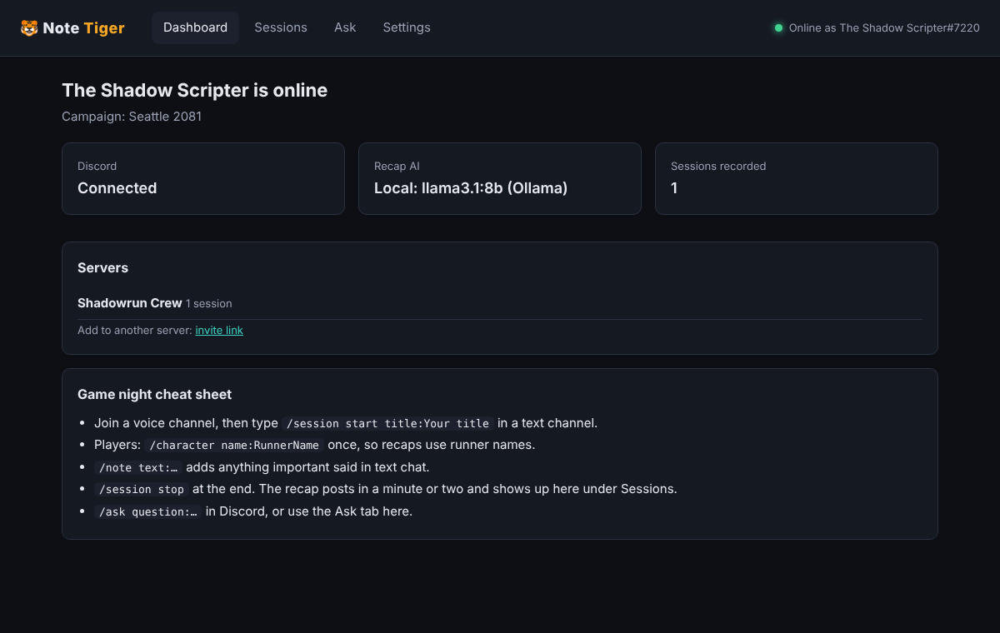
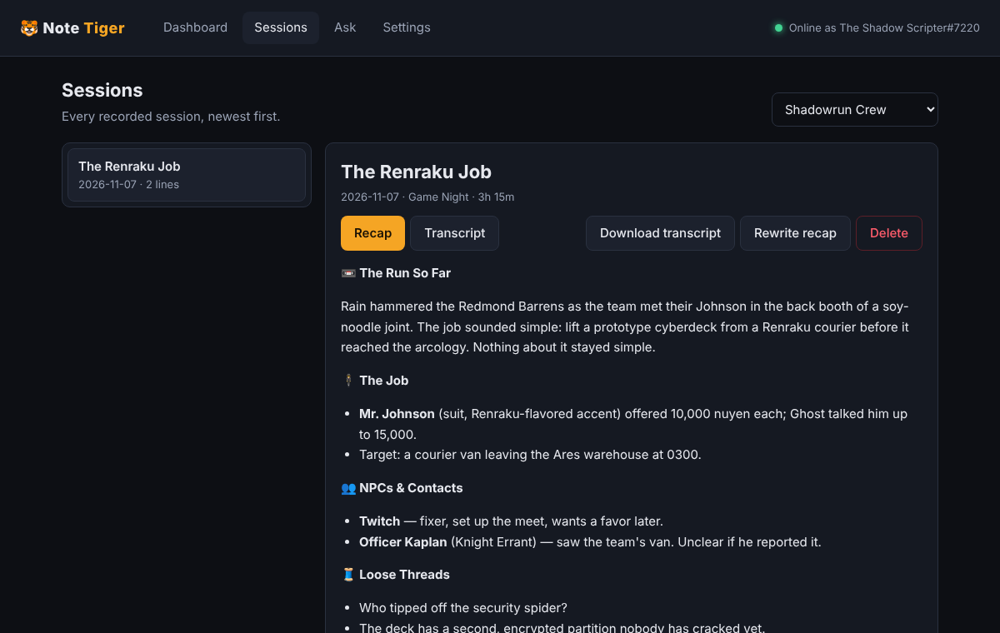

# 🐯 Note Tiger

**A Discord bot that listens to your tabletop RPG sessions, writes the recap for you, and remembers your whole campaign.**

Built for Shadowrun, and it works for any game played over Discord voice.

- 🎙️ Joins your voice channel muted and transcribes everyone at the table
- 📼 Posts a recap when you're done (in **#recaps**): the job, NPCs, places, loot and nuyen, consequences, loose threads, best quotes. The full transcript goes to **#logs**, color-coded with a pastel color per person
- 🎭 Knows who the game master is (by Discord role) and labels their lines as **Narrator**, the **NPC** they're voicing, or the GM speaking out of character
- 🍕 Keeps off-topic table talk out of the recap. It stays in the transcript (dimmed), and the best jokes can still make **Best Lines**
- 🐿️ **Squirrel-o-meter**: how much of the night was actually playing vs. going off on tangents, and who the biggest squirrel was
- 🌐 **Player website**: every session published to a password-protected site (free, on GitHub Pages) where players read recaps and color-coded transcripts on any device
- 🕵️ **Contacts, places & loose ends**: every recap updates a roster of the NPCs you've met, the places you've been, and a list of open leads, debts and threats (`/campaign`, the Campaign tab, and the player website)
- 📖 **The story so far**: one running summary of the whole campaign, updated after every session
- 💬 **Quotes**: every session's Best Lines in one searchable place (and `/campaign quote` for a random one)
- 🔦 **Spotlight meter**: how much each runner talked during the game, next to the squirrel-o-meter
- 🔤 **Spelling fixes**: "wren rocky" becomes Renraku; add your own names and fixes in Settings
- 💾 **Backups** to a private GitHub repository, with one-click restore on a new PC
- 🏃 **Runner profiles**: what each character has done, big moments, gear and how they're doing
- 🔎 **Search every session** on the player website
- 🎲 **GM prep note**: privately messaged to the GM before game night (or `/campaign prep` any time)
- ✏️ **Fix the AI's mistakes**: in the transcript, select lines and mark them table talk / game, or set who the GM was voicing
- 🗓️ **Session timeline**: scene by scene, with squirrel breaks; click a scene to read that part
- 🗂️ **Run history**: every job, who hired you, pay, complications and outcome (`/campaign runs`)
- 🎭 **NPC voice cards for the GM**: personality, how they talk, what they want, their lines (`/campaign npc`, GM only)
- 📕 **Campaign book**: the whole campaign as a PDF (`/campaign book`, or the Campaign tab)
- 🚨 **Alerts**: a Discord DM if the bot crashes, can't hear anyone, or a recap fails
- 🎲 **#gm channel**: prep notes and NPC card updates go to a private GM channel
- ✨ **Automatic updates**: Note Tiger tells you when there's a new version and updates itself in one click
- 📚 **Rulebook lookup**: add your game PDFs, then `/game ask` tells you the book, the printed page number and a quick description
- 🧠 Answers questions about past sessions: *"What did Mr. Johnson offer us for the Ares job?"*
- 🖥️ A proper Windows app: a Note Tiger window with **Start / Stop bot**, sessions, questions and settings, plus a 🐯 tray icon so you know it's running
- 💸 **Free by default:** speech-to-text and the recap AI can both run on your own PC. Nothing gets uploaded.




---

## Install (Windows, about 10 minutes)

### Step 1: Create your Discord bot

1. Go to the **[Discord Developer Portal](https://discord.com/developers/applications)** and click **New Application**. Give it any name.
2. Open the **Bot** tab:
   - Click **Reset Token** and copy the token. You'll paste it into Note Tiger in a minute. **Keep it secret.**
   - Scroll to **Privileged Gateway Intents** and turn on **Server Members Intent**. Click **Save Changes**.
3. Open **OAuth2 → URL Generator**:
   - Under **Scopes**, tick `bot` and `applications.commands`.
   - Under **Bot Permissions**, tick **View Channels**, **Send Messages**, **Attach Files**, **Use Slash Commands**, **Connect** and **Speak**.
   - Copy the URL at the bottom, open it, and add the bot to your server.

### Step 2: Install Note Tiger

1. Download **`NoteTiger-Setup.exe`** from the **[latest release](../../releases/latest)**.
2. Run it and click through. No admin rights are needed, and everything it needs (including Node.js) is built in.
   - Leave **"Free local AI"** ticked if you want free recaps that never leave your PC (downloads about 6.5 GB). Untick it if you'll use a Claude API key.
   - If Windows shows a blue "Windows protected your PC" box, click **More info → Run anyway**. The installer isn't code-signed yet.

### Step 3: Start it

Click **Note Tiger** on your desktop or in the Start menu. The **Note Tiger window** opens and a 🐯 icon appears by the clock.
Go to **Settings**, paste your Discord token, and click **Save**. Then press **Start bot** on the Dashboard. It turns green: **online** 🎉

- **Start bot / Stop bot** is the big button at the top of the Dashboard.
- Closing the window doesn't stop the bot. **Double-click the tiger icon** to open it again.
- **Right-click the tiger icon** to start or stop the bot, open the log or your data folder, or quit Note Tiger.
- The first start downloads the speech-to-text model (a few hundred MB). The dashboard shows when it's ready.

<details>
<summary>Prefer not to use the installer? Run from source</summary>

Download this repo (green **Code** button → **Download ZIP**), unzip it **outside OneDrive**, then double-click **`install.bat`** followed by **`start-bot.bat`**. The panel opens in your browser at <http://localhost:3080>.
</details>

---

## Game night

| In Discord | What happens |
|---|---|
| `/session start title:The Renraku Job` | The bot joins your voice channel and starts transcribing. It posts a 🔴 notice. |
| `/character name:Ghost` | Each player runs this once, so recaps use runner names. |
| *(GM role)* | Give your game master a Discord role called **Game Master** (or GM / Storyteller / DM). Their lines show who they're voicing, e.g. `Seth (GM as Mr. Johnson)`. |
| `/session begin` | Done recapping last session? The GM types this when play starts, so the recap chat stays out of the new notes. (Without it, the AI finds the end of your opening recap on its own.) |
| `/note text:Ghost owes Twitch a favor` | Adds something from text chat to the session. |
| `/session stop` | A minute or two later, posts the recap in **#recaps** and the full transcript in **#logs**. Create those two text channels (or pick other names in Settings); if they don't exist, both go to the channel you typed in. |
| `/ask question:Who was the decker in Redmond?` | Answers from all recorded sessions. |
| `/recap` | Re-posts the latest recap. |
| `/game ask question:How does Edge work?` | Looks it up in your rulebook PDFs: book, page and a short description, plus related pages. Add PDFs in Note Tiger → **Library**. `/game books` lists them. Asked during a session, it's also listed under **📖 Rules Calls** in that night's recap. |
| `/campaign contacts` | Everyone the team has met, with who they are and how they feel about you. Add `name:` for one person's history. |
| `/session catchup` | Missed something? A quick summary of the last 15 minutes (or `minutes:30`), just for you. |
| `/campaign places` · `/campaign story` · `/campaign quote` | Places you've been, the campaign story so far, and a random Best Line. |
| `/campaign runner name:Ghost` | A runner's profile: sessions, big moments, gear, current state. |
| `/campaign prep` | GM only: a private prep note for the next session. Set game night in Settings to get it automatically. |
| `/campaign threads` | Open loose ends, numbered. `/campaign close number:2 how:Paid him back` ties one up; `/campaign add text:…` adds one. Fix anything else in Note Tiger → **Campaign**. |
| `/repost` | Posts a session's recap **and** transcript to #recaps / #logs again, marked 🔁 Updated (e.g. after **Rewrite recap**). Also a **Repost to Discord** button on each session in Note Tiger. |
| `/optout mode:on` | The bot won't record that person's voice. |

In the **control panel** you can also read every recap and transcript, download transcripts, rewrite a recap, delete sessions, ask questions, and change settings.

> **Tell your group before you record.** Everyone in the voice channel is transcribed.

---

## Player website (optional)

Note Tiger can publish every session to a website your players can open on any phone or computer: recaps, the squirrel-o-meter, and searchable color-coded transcripts.

**Private by design:** everything is encrypted with a group password (AES-256-GCM, PBKDF2 key) before it leaves your PC. GitHub and anyone who stumbles on the link only see scrambled data; the page decrypts it in the player's browser after they type the password.

Setup (once):
1. [Create a fine-grained GitHub token](https://github.com/settings/personal-access-tokens/new): *Repository access* → **Only select repositories** → your Note-Tiger repo. *Permissions* → **Contents: Read and write** and **Pages: Read and write**.
2. In Note Tiger → **Settings → Player website**: tick the box, enter your repo (e.g. `yourname/Note-Tiger`), paste the token, choose a group password → **Save & restart**.
3. Click **Publish all sessions now**. Share the link (e.g. `https://yourname.github.io/Note-Tiger/`) and the password with your group.

After that, every session is published automatically when it ends (and again after **Rewrite recap** or **Repost**), and the Discord posts link to it.

> Changing the password re-encrypts everything and the old one stops working. Older encrypted copies stay in the repo's history, still locked with the old password.

## Troubleshooting

| Problem | Fix |
|---|---|
| Dashboard says **"turn on Server Members Intent"** | Developer Portal → Bot → Privileged Gateway Intents → turn on **Server Members Intent** → Save, then click Save & restart in Settings. |
| **"Discord rejected the token"** | Developer Portal → Bot → **Reset Token**, then paste the new token in Settings. |
| Slash commands don't show up | Restart Discord (Ctrl+R). Make sure you ticked `applications.commands` when inviting the bot. |
| **"Could not reach Ollama"** | Open the **Ollama** app (it lives in the system tray by the clock), or run `setup-local-ai.bat` again. |
| Window won't open | Make sure the 🐯 icon is by the clock (start **Note Tiger** from the Start menu), then double-click it. |
| "The bot stopped unexpectedly" | The Dashboard shows why. Click **Show activity log** for details, then **Start bot**. |
| "Another copy is already running" | Close the old black `start-bot.bat` window, then start Note Tiger again. |
| Transcripts are garbled | Use headsets and push-to-talk or noise suppression. Try the **Medium** Whisper model in Settings if your PC is fast. |
| Recording stopped working after a Discord update | Install the newest release over the top. Your settings and sessions are kept. |

---

## Mac / Linux

Requires [Node.js 22.12+](https://nodejs.org) (and [Ollama](https://ollama.com) for free local recaps: `ollama pull llama3.1:8b`).

```bash
npm install
npm run test-speech   # downloads the speech model
./start.sh            # then open http://localhost:3080
```

## Where things are saved

Everything stays on your PC, in `%LOCALAPPDATA%\Programs\Note Tiger\app` (right-click the 🐯 icon → **Open data folder**):
- `.env`: your settings and keys (the control panel edits this for you; never share it)
- `data/`: every session's transcript, notes and recap
- `models/`: the downloaded speech model

Updating or uninstalling keeps your settings and sessions unless you choose to delete them.

Back up `data/` if you care about your campaign history.

## Building the installer

From Linux (or WSL): `sudo apt install gcc-mingw-w64-x86-64 nsis` plus Go 1.24+, then `./installer/build.sh`. The output is `dist/NoteTiger-Setup-<version>.exe`.

- `launcher/`: `Note Tiger.exe`, the tray icon, which keeps the manager running
- `window/`: `Note Tiger Window.exe`, the app window (WebView2)
- `server.js`: the manager, which serves the window's UI and starts/stops the bot
- `index.js`: the bot (Discord, voice, transcription); `ai.js`, `store.js`, `config.js` are shared

## How it works

- **Voice:** [discord.js](https://discord.js.org) + `@discordjs/voice`, with Discord's end-to-end voice encryption (DAVE) support.
- **Speech-to-text:** OpenAI's Whisper model running locally through [Transformers.js](https://huggingface.co/docs/transformers.js). Audio is never saved or uploaded.
- **Recaps & questions:** a local model through [Ollama](https://ollama.com), or Claude if you add an API key. Long sessions are summarized in parts, then combined.

Receiving voice audio isn't officially documented by Discord, so a Discord change could break recording until the voice library catches up.

*Note Tiger is a work in progress. Ideas and bug reports are welcome in Issues!*
